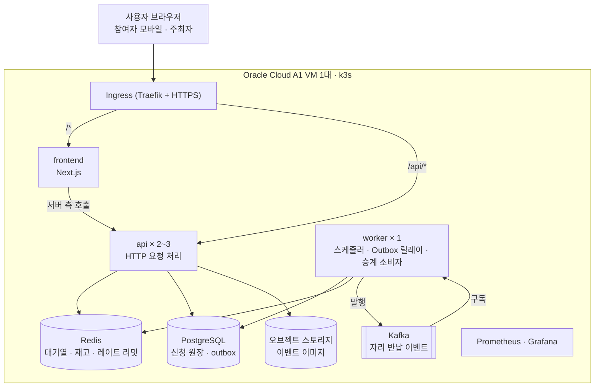
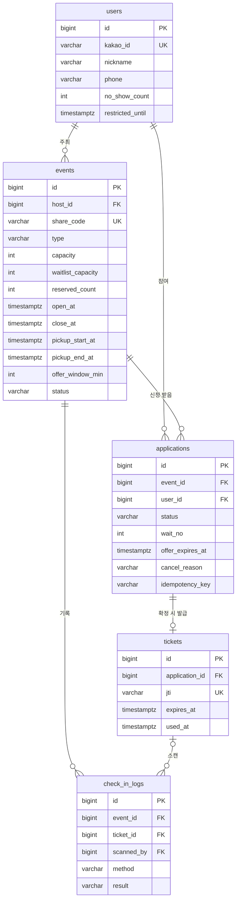

# 호다닥 PRD

> 버전 1.2 · 2026-11-03
> 무엇을, 왜, 어떤 구조로 만드는지 팀이 같은 그림을 보기 위한 문서다. DDL, API 형식, Redis 키, 오류 코드, 배포 설정 같은 구현 세부는 `docs/SPEC.md`가 기준이며, 두 문서가 다르면 함께 고친다.

## 1. 개요

호다닥은 동아리, 학생회 같은 소규모 주최자가 한정 수량 이벤트를 열면, 참여자가 링크로 들어와 선착순으로 신청하고 현장에서 QR로 수령·입장하는 웹 서비스다. 이름은 오픈되자마자 "호다닥" 달려가는 선착순의 순간에서 왔다.

- **이벤트 유형**: 무료 신청형(굿즈 나눔, 특강, 행사 좌석, 스터디 모집)과 현장 결제 예약형(축제 부스, 동아리 굿즈 판매). 예약형의 가격은 표시만 하며, 결제는 현장에서 주최자와 참여자가 직접 한다. 호다닥은 결제를 처리하지 않는다.
- **팀과 기간**: 2명(풀스택 1, 백엔드 1), 8주. 웹으로 먼저 출시하고 이후 React Native로 주최자용 iOS 앱을 만든다.
- **운영 환경**: Oracle Cloud 무료 티어 VM 1대의 쿠버네티스(k3s)에 프론트엔드, 백엔드, 데이터 저장소를 모두 올린다.
- **비용 원칙**: 외부 유료 데이터, 유료 알림(문자·알림톡), 유료 서버 없이 운영한다. 도메인 비용만 예외다.

## 2. 문제와 목표

### 2.1 해결하는 문제

| 지금 방식 (구글폼·카톡·DM) | 생기는 문제 | 호다닥의 해결 |
| --- | --- | --- |
| 선착순 마감을 사람이 직접 확인 | 수량보다 많이 받는다 | 서버가 수량을 원자적으로 차감해 초과 확정 0건 |
| 같은 사람이 여러 번 제출 | 중복 신청 | 계정당 이벤트별 1회만 신청 |
| 오픈 순간 접속 폭주 | 폼 마비, 매크로가 유리 | 대기열과 요청 제한 |
| 취소된 자리를 수동으로 재배정 | 운영진 부담, 공정성 시비 | 대기자에게 순서대로 자동 승계 |
| 현장에서 명단 대조 | 줄 지연, 대리 수령 | 1회용 QR 체크인 |
| 신청만 하고 안 옴 | 물량 낭비 | 노쇼 기록 (제한 정책은 이후) |

### 2.2 목표

1. 실제 행사 1건 이상에서 운영하고 신청자 수, 수령률, 운영진 피드백을 기록한다.
2. 어떤 부하에서도 초과 확정 0건, 중복 신청 0건, 티켓 중복 사용 0건을 보장한다.
3. 무료 VM 한 대에서 버틸 수 있는 한계를 측정하고 병목을 문서로 남긴다.
4. 동시성 처리 방식 4가지 비교 결과와 트러블슈팅 5건 이상을 기록한다.

## 3. 사용자

| 사용자 | 누구 | 환경 | 주요 행동 |
| --- | --- | --- | --- |
| 주최자 | 동아리 운영진, 학생회, 소규모 굿즈 판매자 | 모바일(현장 스캔), PC(이벤트 관리) | 이벤트 생성, 링크 공유, 현황 확인, QR 스캔 |
| 참여자 | 링크를 받은 학생, 일반인 | 모바일 브라우저 (카톡·인스타 인앱 브라우저 포함) | 오픈 대기, 신청, 승계 수락, QR 제시, 취소 |
| 운영팀 | 우리 팀 | PC | 모니터링(Grafana), 어뷰징 대응 (MVP는 DB 직접 조회) |

주최자 가입은 따로 없다. 로그인한 사용자는 누구나 이벤트를 만들 수 있고, 누구나 참여자가 될 수 있다.

## 4. 핵심 시나리오

1. 주최자가 이벤트를 만들고 공개한다.
2. 주최자가 공유 링크를 카톡·인스타에 올린다. 링크 미리보기에 제목, 이미지, 오픈 시각이 보인다.
3. 참여자가 링크로 들어와 카카오로 로그인하고 오픈 카운트다운을 본다.
4. 오픈 시각에 "신청하기"를 누르면 대기열에 들어가 순번을 본다.
5. 차례가 오면 신청이 자동으로 전송된다.
6. 결과는 확정(QR 발급), 대기자 등록(대기 번호), 마감 중 하나다.
7. 확정자가 취소하면 가장 앞 대기자에게 자리가 제안된다. 기한 안에 수락하면 확정, 넘기면 다음 대기자로 넘어간다.
8. 현장에서 주최자가 QR을 스캔해 수령·입장을 처리한다.
9. 수령 기간이 끝나면 미수령 확정자는 노쇼로 기록된다.

## 5. 기능 요구사항

### 5.1 MVP

| ID | 기능 | 설명 | 담당 |
| --- | --- | --- | --- |
| F1 | 카카오 로그인 | 로그인 유지, 토큰 자동 재발급 | 풀스택 |
| F2 | 이벤트 관리 | 생성, 임시 저장, 수정, 공개, 취소 | 풀스택 |
| F3 | 공개 이벤트 페이지 | 링크 미리보기(OG), 서버 시각 기준 카운트다운, 상태별 버튼 | 풀스택 |
| F4 | 선착순 신청 | 초과 확정·중복 신청 0건, 재시도해도 결과가 같은 멱등 처리 | 백엔드 |
| F5 | 대기열 | 오픈 순간 순번 대기, 입장 토큰 발급 | 백엔드 |
| F6 | 대기자 등록·자동 승계 | 취소·만료로 자리가 나면 다음 대기자에게 기한부 제안 | 백엔드 |
| F7 | 취소·수락·포기 | 참여자가 신청을 취소하거나 승계 제안에 응답 | 백엔드(API), 풀스택(화면) |
| F8 | QR 티켓·체크인 | 1회용 QR, QR 스캔과 수동 체크인 | 풀스택 |
| F9 | 주최자 현황판 | 상태별 숫자, 명단 검색, 링크 복사 | 풀스택 |
| F10 | 종료 처리 | 미수령 노쇼 기록, 남은 대기·제안 만료 | 풀스택 |
| F11 | 요청 제한 | 사용자·IP 단위 레이트 리밋, 매크로 완화 | 백엔드 |
| F12 | 이미지 업로드 | 이벤트당 1장, 최대 5MB | 풀스택 |

### 5.2 이후 단계 (MVP에서 구현하지 않음)

- 노쇼 누적 시 신청 제한 (데이터 필드는 MVP에 둔다)
- 공동 주최자 (운영진 여러 명이 스캔·관리)
- 알림 (확정·승계 푸시, 이메일)
- 관리자 화면
- React Native iOS 주최자 앱
- GitOps(Argo CD), 다중 노드 클러스터

## 6. 핵심 정책

- **1인 1회**: 한 계정은 한 이벤트에 한 번만 신청할 수 있다. 취소한 뒤에도 다시 신청할 수 없다.
- **확정과 대기**: 자리가 남아 있으면 즉시 확정하고 QR을 발급한다. 자리가 다 차면 대기 번호를 준다. 대기 인원에도 상한이 있으며 기본값은 수량과 같다. 둘 다 차면 마감이다.
- **승계**: 자리가 나면 대기 번호가 가장 빠른 사람에게 제안한다. 기본 30분 안에 수락해야 하고, 넘기거나 포기하면 다음 사람에게 넘어간다. 수령 마감 30분 전부터는 승계하지 않는다.
- **취소**: 수령 마감 전까지 취소할 수 있다. 수령한 뒤에는 취소할 수 없다.
- **체크인**: 해당 이벤트의 주최자만 스캔할 수 있고, 수령 시작 30분 전부터 수령 마감까지 허용한다. QR은 1회만 쓸 수 있다.
- **종료**: 수령 마감이 지나면 미수령 확정자는 노쇼, 남은 대기자와 제안은 만료 처리한다.
- **예약형**: 신청 시 전화번호가 필요하다. 주최자 명단에는 뒷 4자리만 보인다.
- **주최자**: 자기 이벤트에는 신청할 수 없다. 오픈 이후에는 설명, 이미지, 장소만 수정할 수 있다.

## 7. 화면 목록

참여자 화면은 모바일 기준으로, 주최자 화면은 모바일과 PC 모두에서 쓸 수 있게 만든다.

| # | 화면 | 경로 | 사용자 | 핵심 내용 |
| --- | --- | --- | --- | --- |
| 1 | 랜딩 | `/` | 모두 | 서비스 소개, "이벤트 만들기" |
| 2 | 로그인 | `/login` | 모두 | 카카오 로그인, 원래 보던 페이지로 복귀 |
| 3 | 이벤트 상세 (공유 페이지) | `/e/[shareCode]` | 참여자 | 링크 미리보기, 카운트다운, 남은 수량, 상태별 신청 버튼 |
| 4 | 대기열 | `/e/[shareCode]/queue` | 참여자 | 현재 순번, 예상 대기 시간, 자동 신청 |
| 5 | 신청 결과 | `/e/[shareCode]/result` | 참여자 | 확정, 대기 번호, 마감 중 하나 |
| 6 | 내 신청 목록 | `/me/applications` | 참여자 | 진행 중, 지난 신청 탭 |
| 7 | 신청 상세 | `/me/applications/[id]` | 참여자 | QR, 승계 제안 수락·포기, 취소 |
| 8 | 마이페이지 | `/me` | 모두 | 닉네임, 전화번호 |
| 9 | 내 이벤트 목록 | `/host/events` | 주최자 | 예정, 진행, 종료 구분 |
| 10 | 이벤트 만들기 | `/host/events/new` | 주최자 | 단계형 폼: 기본 정보 → 수량 → 일정 → 미리보기 |
| 11 | 이벤트 수정 | `/host/events/[id]/edit` | 주최자 | 상태에 따라 수정 가능한 항목만 활성화 |
| 12 | 현황판 | `/host/events/[id]` | 주최자 | 확정·수락 대기·대기·수령·노쇼 수, 명단, 링크 복사 |
| 13 | QR 스캔 | `/host/events/[id]/scan` | 주최자 | 카메라 스캔, 결과를 색과 문구로 크게 표시 |
| 14 | 수동 체크인 | `/host/events/[id]/check-in` | 주최자 | 닉네임·전화 뒷 4자리 검색 후 체크인 |
| 15 | 카카오 로그인 콜백 | `/auth/kakao/callback` | 모두 | 화면 없이 처리 후 이동 |

이벤트 상세(3번)는 비로그인, 오픈 전, 신청 가능, 대기만 가능, 마감, 종료, 취소됨, 이미 신청함, 본인이 주최자, 전화번호 필요 등 상태가 많아 화면 하나지만 가장 손이 많이 간다. 모든 데이터 화면에는 로딩, 빈 상태, 오류(재시도) 상태를 둔다.

## 8. 비기능 요구사항

| 항목 | 목표 |
| --- | --- |
| 정합성 | 초과 확정 0건, 같은 사용자 중복 신청 0건, 티켓 중복 사용 0건 |
| 성능 | 운영 VM에서 신청 API p95 500ms 이하, 오류율 1% 미만을 지키는 최대 동시 사용자 수를 측정해 기록 (첫 가설 2,000명) |
| 가용성 | 서버가 재시작돼도 확정 데이터 유실 없음, Redis 재고는 DB 기준으로 복구 |
| 무중단 | 롤링 배포나 파드 강제 종료 중에도 신청 유실 0건 |
| 보안 | QR 서명·만료 검증, 주최자 권한 검증, 로그에 개인정보·토큰 미기록, 모니터링·k8s API 외부 비공개 |
| 개인정보 | 닉네임과 (예약형만) 전화번호만 수집, 개인정보 처리방침 게시 |
| 관측성 | 요청 수, 지연, 대기열 길이, 확정 수, outbox 적체, 정합성 불일치를 대시보드로 확인 |

## 9. 범위 제외

- 온라인 결제, 정산, 수수료
- 좌석 지정 (수량만 관리)
- 앱 푸시, 문자, 알림톡

## 10. 아키텍처

호다닥은 Spring Boot 모듈러 모놀리스를 **api**와 **worker** 두 역할로 나눠 띄우고, Redis, PostgreSQL, Kafka를 붙인 구조다. 선착순 경쟁은 Redis에서 원자적으로 가르고, 결과는 PostgreSQL에 트랜잭션으로 남기며, 취소·만료 후속 처리는 Kafka 이벤트로 분리한다. 서비스는 쪼개지 않고 모듈과 실행 역할만 나눈다.

### 10.1 선착순 신청 흐름

1. 오픈 시각 전 요청은 거부한다. 공개 이벤트 정보는 Redis에 캐시한다.
2. 오픈 후 "신청하기"를 누르면 Redis 대기열에 들어가고, 화면은 2초 간격으로 순번을 조회한다.
3. worker가 1초마다 정해진 인원(기본 200명)씩 꺼내 60초짜리 입장 토큰을 준다. 입장 토큰이 있어야 신청 API를 호출할 수 있다.
4. 신청 API는 Redis Lua 스크립트 하나로 "중복 확인 + 재고 차감 + 대기 번호 발급"을 원자적으로 처리한다.
5. 결과를 DB 트랜잭션 하나로 저장한다. 확정이면 `events.reserved_count` 증가(CHECK 제약이 2차 방어선), 신청 저장, 티켓 발급을 함께 한다. DB 저장이 실패하면 Redis를 되돌린다.
6. 확정자는 서명된 QR 토큰을 받는다.

### 10.2 승계 흐름

1. 확정자 취소, 제안 포기, 제안 기한 초과가 일어나면 상태 변경과 `outbox_events` 기록을 한 트랜잭션에 저장한다.
2. worker의 Outbox 릴레이가 이를 Kafka `hodadak.seat-released` 토픽(키 = 이벤트 ID)으로 발행한다.
3. worker의 승계 소비자가 가장 앞 대기자를 `OFFERED`로 바꾸고 수락 기한을 건다. 대기자가 없고 신청 기간이면 Redis 재고를 1 늘린다.
4. 같은 메시지가 두 번 와도 결과가 같도록 처리 이력으로 멱등을 보장한다.

### 10.3 서버가 여러 개여도 안전한 이유

| 위험 | 대응 |
| --- | --- |
| 스케줄 잡이 파드마다 실행 | 잡은 worker에만 두고 ShedLock으로 한 곳에서만 실행 |
| 재시작한 파드가 Redis 재고를 덮어씀 | 재구성은 worker에서만, 키가 없을 때만 |
| 요청이 매번 다른 파드로 감 | 세션 없는 JWT, 상태는 모두 Redis·DB, 재시도는 멱등 키로 1회 처리 |
| 배포 중 요청 유실 | readiness 프로브, graceful shutdown, 롤링 배포 시 가용 파드 유지 |

### 10.4 동시성 처리 비교 실험

같은 시나리오(수량 100, 동시 요청 단계적 증가)로 네 방식을 구현해 k6로 비교한다. "예상"은 가설이며 측정 결과로 바꿔 적는다.

| 방식 | 구현 | 예상 |
| --- | --- | --- |
| DB 비관적 락 | `SELECT … FOR UPDATE` | 정합성은 맞지만 커넥션 대기로 처리량 저하 |
| DB 낙관적 락 | `events.version` + 재시도 | 충돌 시 재시도가 몰려 실패율 상승 |
| Redis 분산 락 | 이벤트 단위 락 | 정합성 확보, 락 경합 비용 |
| Redis 원자 연산 (채택) | Lua 스크립트 | 가장 빠름, DB와 불일치 시 복구 설계 필요 |

### 10.5 기술 스택

| 영역 | 선택 |
| --- | --- |
| 백엔드 | Java 21, Spring Boot 4.1.0, Spring Data JPA, Flyway, ShedLock |
| DB | PostgreSQL (운영: CloudNativePG) |
| 캐시·대기열 | Redis |
| 메시징 | Kafka KRaft (운영: Strimzi) |
| 프론트엔드 | Next.js (App Router, standalone), TypeScript, Tailwind CSS, TanStack Query |
| 이미지 저장 | S3 호환 오브젝트 스토리지 (제품 결정 중) |
| 테스트 | JUnit, Testcontainers, k6 |
| 모니터링 | Prometheus, Grafana (kube-prometheus-stack) |
| 인프라 | 로컬 Docker Compose, 운영 k3s, Kustomize, cert-manager, GitHub Actions, GHCR |
| 이후 | React Native (iOS 주최자 앱), Argo CD |

## 11. 배포 구성

| 항목 | 내용 |
| --- | --- |
| 서버 | Oracle Cloud Always Free, Ampere A1 VM 1대 (arm64, 2 OCPU, 12GB) |
| 쿠버네티스 | k3s 단일 노드 |
| 도메인 | 하나의 도메인. `/api`는 백엔드, 나머지는 프론트 (같은 오리진이라 CORS·쿠키 문제 없음) |
| 개발 환경 | 각자 노트북의 Docker Compose, 매니페스트는 k3d로 검증 |
| 이미지 | GitHub Actions에서 arm64로 빌드, GHCR 저장 |
| 배포 | `v1.2.3` 같은 버전 태그를 만들면 운영에 배포, 문제 시 이전 태그로 롤백 |
| 자원 | 평상시 약 10.7GB / 12GB 사용 예상. api는 2개, 필요 시 3개까지 |

알고 있어야 할 한계:
- **노드가 하나라 고가용성은 없다.** VM이 멈추면 서비스 전체가 멈춘다. 그래서 DB 백업은 VM 밖으로 보낸다.
- **파드를 늘려도 처리량은 크게 늘지 않는다.** CPU와 메모리가 한 대분이기 때문이다. 파드를 여러 개 두는 목적은 처리량보다 **무중단 배포와 장애 격리**다.
- **스테이징이 없다.** 운영 적용 전 k3d로 검증하고, 실제 행사 전후 3일은 큰 배포와 부하 테스트를 하지 않는다.

## 12. 데이터 모델

신청·대기·승계·취소·수령·노쇼는 모두 `applications` 한 테이블의 상태 전이로 표현한다. `events.reserved_count`는 자리를 차지한 신청 수이며 수량을 넘을 수 없다. 컬럼 전체와 DDL은 SPEC §7에 있다.

이 외에 메시징용 `outbox_events`(발행 대기 이벤트), `processed_messages`(소비 이력), 스케줄 잡 락용 `shedlock`이 있다.

### 12.1 신청 상태

| 상태 | 의미 | 자리 차지 |
| --- | --- | --- |
| `WAITING` | 대기자 (대기 번호 보유) | 아니오 |
| `OFFERED` | 승계 제안, 수락 기다리는 중 | 예 |
| `CONFIRMED` | 확정, QR 발급 | 예 |
| `USED` | 수령·입장 완료 | 예 |
| `NO_SHOW` | 수령 기간 내 미수령 | 예 |
| `CANCELED` | 본인 취소, 제안 포기, 이벤트 취소 | 아니오 |
| `EXPIRED` | 제안 기한 초과, 종료 시 남은 대기 | 아니오 |

주요 전이: 신청 → `CONFIRMED` 또는 `WAITING` · `WAITING → OFFERED → CONFIRMED` · `OFFERED → EXPIRED` · `CONFIRMED → CANCELED | USED | NO_SHOW`. 정의되지 않은 전이는 거부한다.

### 12.2 정합성 장치

- `UNIQUE(event_id, user_id)`: 1인 1회 신청
- `UNIQUE(user_id, idempotency_key)`: 같은 요청 재시도 시 같은 결과
- `CHECK(reserved_count <= capacity)`: Redis가 틀려도 DB에서 초과 확정 차단
- `UPDATE tickets SET used_at = now WHERE used_at IS NULL`: QR 동시 스캔 시 1회만 성공
- `processed_messages`: Kafka 메시지 중복 소비 방지

## 13. 역할 분담

백엔드는 도메인 기준으로 나눈다. 풀스택 담당이 프론트 전체와 인증·이벤트·QR 도메인을, 백엔드 담당이 신청·대기열·승계 도메인과 쿠버네티스 인프라를 맡는다. 선착순 핵심 로직을 한 사람이 끝까지 책임져 동시성 설계가 흩어지지 않게 한다.

| 영역 | 풀스택 | 백엔드 |
| --- | --- | --- |
| 프론트엔드 | Next.js 전체 (화면 1~15), 프론트 이미지·매니페스트 | 대기열·신청 API 응답 규격 협의 |
| 인증 | 카카오 로그인, JWT 발급·재발급 | |
| 이벤트 | 이벤트 관리, 상태 스케줄러, 이미지 업로드, OG 메타, 종료 처리 | |
| 신청·재고 | | Lua 스크립트, DB 정합성, 재고 초기화·재구성, 동시성 방식 비교 |
| 대기열 | | 대기열, 입장 토큰, 레이트 리밋 |
| 승계 | | Outbox 릴레이, Kafka, 승계 워커, 제안 만료, ShedLock |
| QR·체크인 | QR 발급, 스캔·수동 체크인, 현황판 | |
| 인프라 | 로컬 Compose 공동 관리 | Oracle VM, k3s, 오퍼레이터, Ingress·HTTPS, 배포 워크플로, 모니터링, 백업 |
| 검증 | E2E 시나리오, 실제 행사 운영 | 동시성 테스트, k6 부하 테스트, 무중단 배포 검증 |

### 13.1 협업 규칙

- **저장소**: 모노레포 하나 (`backend/`, `frontend/`, `infra/`, `loadtest/`, `docs/`).
- **브랜치**: GitHub Flow. `main` 직접 push 금지, `feat/…`, `fix/…` 브랜치에서 작업.
- **PR**: 상대방 승인 1명 + CI 통과 후 Squash merge. 제목은 `feat(apply): …` 형식.
- **1주차에 API 명세 확정**: OpenAPI 문서와 Mock 응답을 먼저 만들어 프론트가 백엔드를 기다리지 않게 한다.
- **공통 영역은 한 명이 소유**: 엔티티 기반, 공통 예외, 인증 필터는 풀스택 담당이 먼저 만들고 리뷰로 합의한다.
- **트러블슈팅은 즉시 기록**: `docs/troubleshooting/`에 문제, 원인, 시도, 결과, 수치를 남긴다.
- **AI 도구**: `AGENTS.md`(공통 규칙), `CLAUDE.md`(Claude Code 전용)를 따르고 마일스톤 단위로 맡긴다.

## 14. 일정

| 주차 | 마일스톤 | 담당 | 완료 기준 |
| --- | --- | --- | --- |
| 1 | M0 기반 세팅 | 함께 | 로컬에서 전체 기동, CI 통과, API 명세 초안 |
| 1~2 | M0-K 클러스터 | 백엔드 | 도메인으로 프론트·API 접속, 파드 정상, DB 백업 1회 성공 |
| 1~2 | M1 인증 | 풀스택 | 로그인 유지, 만료 시 자동 재발급 |
| 2~3 | M2 이벤트 | 풀스택 | 카톡 링크 미리보기 노출, 상태 자동 전환 |
| 3~4 | M3 신청 핵심 | 백엔드 | 1,000명 동시 신청에서 확정 정확히 100건, 비교 실험 초안 |
| 4~5 | M4 대기열 | 백엔드 (화면: 풀스택) | 대기열을 거친 신청 E2E 성공 |
| 5~6 | M5 취소·승계 | 백엔드 (화면: 풀스택) | 50명 동시 취소 시 대기자 50명 순서대로 제안, 중복 메시지 무해 |
| 6 | M6 체크인·종료 | 풀스택 | 실제 폰 2대로 스캔 성공, 동시 스캔 1회만 성공 |
| 7 | M7 품질 | 함께 | 한계 동시 사용자 수와 병목 문서화, 롤링 배포 중 신청 유실 0건 |
| 8 | M8 출시 | 함께 | `v1.0.0` 배포, 실제 행사 1건 운영, README와 트러블슈팅 정리 |

클러스터 구축(M0-K) 때문에 백엔드의 M3 시작이 며칠 늦어질 수 있다. 밀리면 M7의 오토스케일링과 대시보드 다듬기를 먼저 뺀다.

## 15. 열린 질문

- [ ] 첫 실제 행사 섭외처와 날짜 (정해지면 M8 일정 조정)
- [ ] 도메인 구매와 이름 (M0-K 전에 필요)
- [ ] 오브젝트 스토리지 제품 (SeaweedFS, Garage, 외부 버킷 중 선택)
- [ ] DB 백업을 보낼 VM 밖 저장소
- [ ] 비회원 신청(전화번호 인증) 허용 여부 — 기본값: 불허, 카카오 로그인만
- [ ] 노쇼 제한 기준 — 기본값: 이후 단계에서 결정
- [ ] 영문 서비스명 (비슷한 이름의 기존 서비스 확인)

## 16. 변경 이력

| 날짜 | 버전 | 내용 |
| --- | --- | --- |
| 2026-11-03 | 1.2 | 운영 환경을 Oracle Cloud A1 VM 1대 k3s로 확정, 프론트도 클러스터에 배포(같은 도메인), api/worker 분리, 성능 목표를 한계 측정으로 변경, 모노레포·Git 규칙 추가, 일정에 M0-K 추가 |
| 2026-11-02 | 1.1 | 서비스 이름 커밍 → 호다닥. `confirmed_count`를 `reserved_count`로 변경, 대기 인원 상한 추가, 1인 1회 신청 규칙 확정, 화면 목록·일정·핵심 정책 추가 |
| 2026-11-02 | 1.0 | 초안 작성 |
